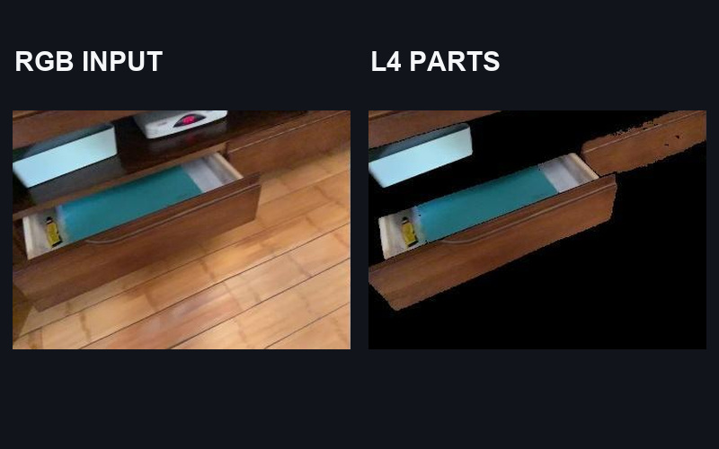
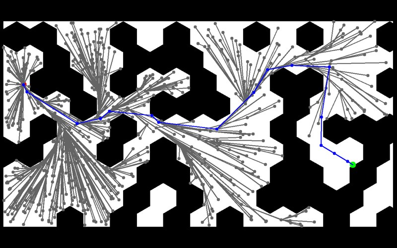
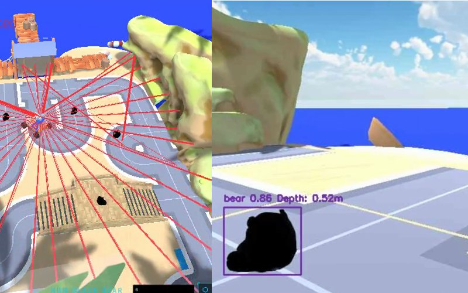
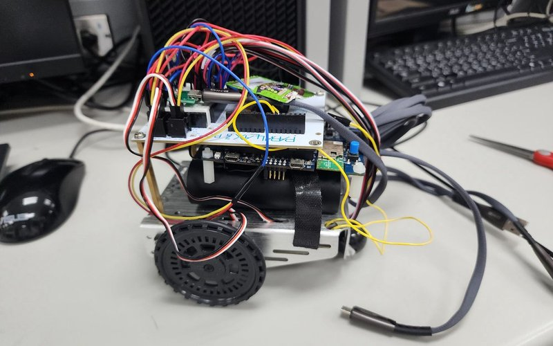

### Hi, I'm Rich (Hsiang-Yu Kung)

I'm an MS Robotics student at the **University of Michigan**, and I want to build autonomous vehicles.

Before Michigan I studied Electrical Engineering at National Tsing Hua University in Taiwan. There I did research on open-vocabulary 3D perception, implemented planning, control and reinforcement-learning methods for robot navigation, and built small robots from the firmware up.

[LinkedIn](https://www.linkedin.com/in/richkung) · [Email](mailto:odyssey@umich.edu)

#### Featured work

<table>
  <tr>
    <td width="50%" valign="top">
      
       <b><a href="https://github.com/RICHKUNG/FamilyPart">FamilyPart</a></b>
       Training-free, open-vocabulary 3D part segmentation from posed RGB-D video. Undergraduate research, Vision Science Lab, NTHU.
       Semantic-SAM · SAM2 · SigLIP · point clouds
    </td>
    <td width="50%" valign="top">
      
       <b><a href="https://github.com/RICHKUNG/motion-planning-and-control">motion-planning-and-control</a></b>
       A* and RRT* planning, curvature-limited speed profiles, and PID / Pure Pursuit / Stanley / LQR path tracking compared on F1 tracks in simulation.
       A* · RRT* · Stanley · Pure Pursuit · LQR · bicycle model
    </td>
  </tr>
  <tr>
    <td width="50%" valign="top">
      
       <b><a href="https://github.com/RICHKUNG/ros2-autonomous-pick-and-place">ros2-autonomous-pick-and-place</a></b>
       ROS 2 mission stack that finds, localizes and grasps objects with a 5-DOF arm, including a controller that runs without Nav2.
       ROS 2 · YOLO · TF2 · Nav2 · visual servoing
    </td>
    <td width="50%" valign="top">
      
       <b><a href="https://github.com/RICHKUNG/STM32-Line-Follower-MQTT">STM32-Line-Follower-MQTT</a></b>
       Line-following car that makes every driving decision on board, plus a touchscreen dashboard linked over MQTT.
       STM32 · Mbed OS · LVGL · MQTT
    </td>
  </tr>
</table>

#### More projects

- **[rne-reinforcement-learning](https://github.com/RICHKUNG/rne-reinforcement-learning)**: PPO for simulated path tracking and reward design for checkpoint navigation, including a revised reward aimed at the circling a distance-heavy reward produced.
- **[ecg-pulse-runner](https://github.com/RICHKUNG/ecg-pulse-runner)**: a runner game driven by your heartbeat and your voice. Training-free MFCC-DTW command recognition, 85.3% accurate on an unseen speaker.
- **[CommitteeAI](https://github.com/RICHKUNG/CommitteeAI)**: a chair LLM designs its own committee of agents, runs their discussion and writes the synthesis.
- **[Sand-Drawing-Robot](https://github.com/RICHKUNG/Sand-Drawing-Robot)**: an ESP32 two-link polar sand table with closed-form inverse kinematics.

#### Toolbox

- **Planning & control:** ROS 2 · Nav2 · A* / RRT* · PID / Pure Pursuit / Stanley / LQR · PPO
- **Perception:** YOLO · SAM2 · CLIP / SigLIP · point clouds
- **Embedded:** STM32 · ESP32 · Mbed OS · MQTT
- **General:** Python · C++ · Linux · Git
